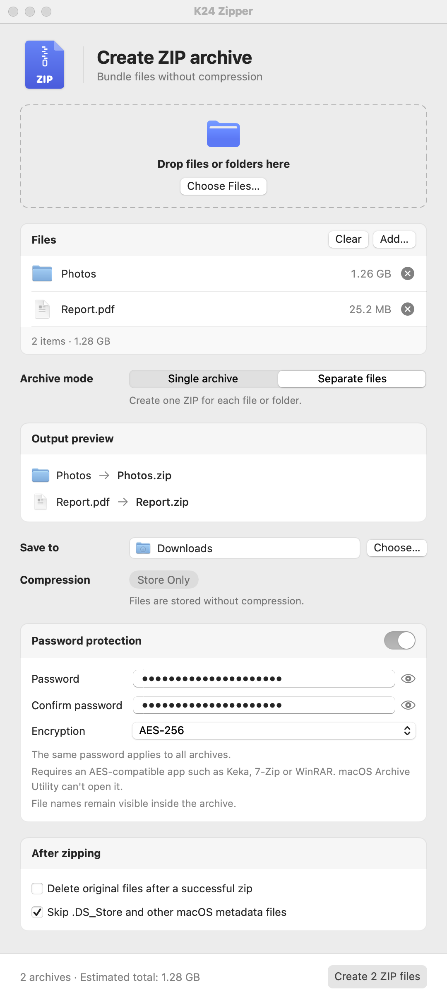
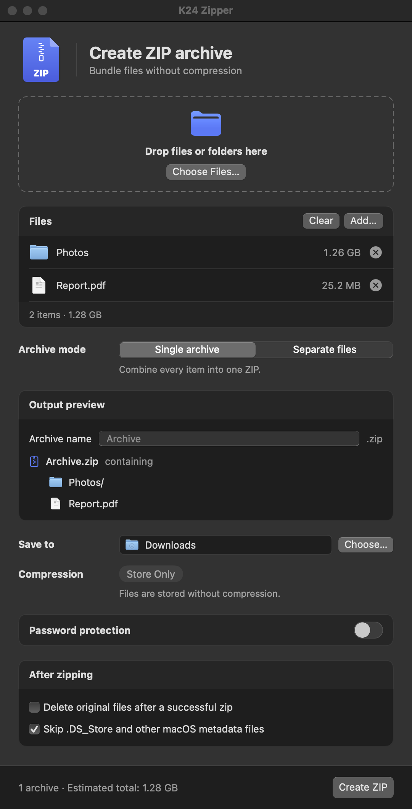

# K24 Zipper

macOS app (Swift / SwiftUI) for creating **Store Only** ZIP archives (no compression), with optional password protection.

<p align="center">
  
  
</p>

## Download
**[⬇ Download the latest release](https://github.com/27sec/K24-Zipper/releases/latest)**. Current version: [K24-Zipper-1.0.0-macOS.zip](https://github.com/27sec/K24-Zipper/releases/download/v1.0.0/K24-Zipper-1.0.0-macOS.zip)

Requires macOS 14 or later. Universal app (Apple Silicon and Intel).

1. Unzip the download and move **K24 Zipper.app** to the Applications folder.
2. The app is not notarized by Apple, so macOS blocks the first launch. Right-click the app → **Open** → **Open**.
3. If macOS says the app is damaged, run:
   ```bash
   xattr -dr com.apple.quarantine "/Applications/K24 Zipper.app"
   ```

## Features
- **Single archive**: combine every item into one ZIP (you can name it).
- **Separate files**: one ZIP per file or folder (`Photos` → `Photos.zip`, `Report.pdf` → `Report.zip`).
- **Output preview** shows the final file names before anything is created. Names that already exist get a number (`Report 2.zip`).
- **Password protection**
  - **AES-256** (WinZip AE-2): strong. Opens in Keka, 7-Zip, WinRAR and The Unarchiver. macOS Archive Utility can't open it.
  - **ZipCrypto**: opens in Archive Utility and Windows Explorer, but the encryption is weak.
  - File names stay visible. Symlinks are stored unencrypted because they hold only a path.
- **Delete originals after zipping** (Move to Trash or Delete permanently). An original is removed only after its archive has been written to disk *and* verified. If an archive fails, its originals are kept.
- ZIP64 (files and archives over 4 GB), UTF-8 file names (Thai works), Unix permissions, symlinks.
- Archives are written to a temporary `.part` file and renamed when finished, so a cancelled or failed run leaves nothing half-written.
- You can drop files on the window or on the Dock icon.

## Build
Requires macOS 14+ and the Swift toolchain (Xcode or Command Line Tools).

```bash
./Scripts/build-app.sh          # → dist/K24 Zipper.app
```

To regenerate the README screenshots (renders the window offscreen; your saved settings are not changed):
```bash
swift build -c release
.build/release/K24Zipper --snapshot docs/screenshot-light.png --password PATHS…
.build/release/K24Zipper --snapshot docs/screenshot-dark.png --dark --single PATHS…
```

## Command line
```bash
"dist/K24 Zipper.app/Contents/MacOS/K24Zipper" --cli [--separate] [--name NAME] \
    [--password PW] [--zipcrypto] [--trash|--delete] [--keep-junk] --out DIR paths…
```

## Code layout
- `Sources/ZipperCore/ZipWriter.swift`: ZIP writer (stored method, ZIP64, AES/ZipCrypto)
- `Sources/ZipperCore/Crypto.swift`: CRC-32, WinZip AES-256 (CTR + HMAC-SHA1), ZipCrypto
- `Sources/ZipperCore/ArchiveJob.swift`: name planning, file scanning, verification, deleting originals
- `Sources/K24Zipper/`: SwiftUI interface
